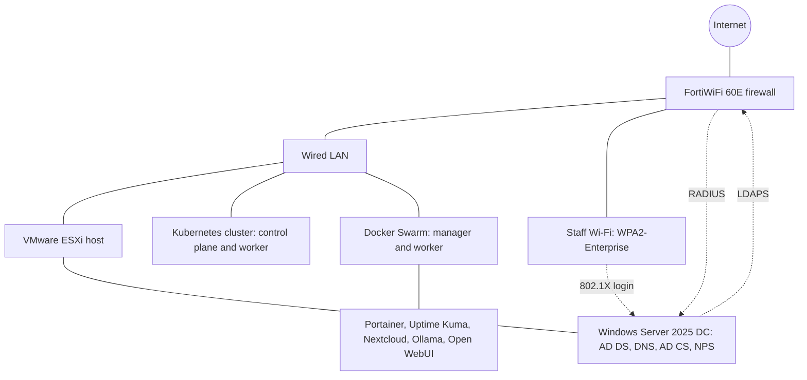
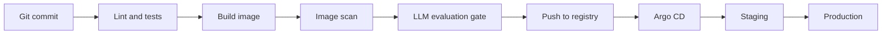

# homelab-platform

Home lab for practicing senior infrastructure and AI-Ops work: CI/CD, LLMOps, monitoring, security and compliance. This is a lab, not a production system. Each project has design notes, configs and evidence in this repo.

## Current lab architecture

## Target CI/CD and LLMOps pipeline (Project 1, planned)

## Projects

| # | Project | Main folders | Status |
|---|---------|--------------|--------|
| 1 | CI/CD and LLMOps pipeline | pipelines, k8s, iac | Not started |
| 2 | Design docs, ADRs and mentoring material | docs/design, docs/adr | Not started |
| 3 | Monitoring and staged incidents | monitoring, docs/incidents | Not started |
| 4 | LLM gateway and agent security | docs/security | Not started |
| 5 | Compliance as code | docs/security, k8s | Not started |
| 6 | Platform roadmap | docs/roadmap | Not started |
| 7 | On-call simulation | docs/runbooks | Not started |

Already built outside this repo: Active Directory with LDAPS, an Enterprise CA, NPS (RADIUS) and WPA2-Enterprise Wi-Fi on a FortiWiFi.

## Repo layout

- docs/design, docs/adr, docs/runbooks, docs/incidents, docs/security, docs/roadmap
- pipelines, iac, k8s, monitoring

## Security practices

- No secrets in Git. A .gitignore blocks common secret files, and gitleaks scans the repo.
- Internal addresses and credentials are never published.

Secrets scanning: gitleaks runs as a pre-commit hook on every commit.
